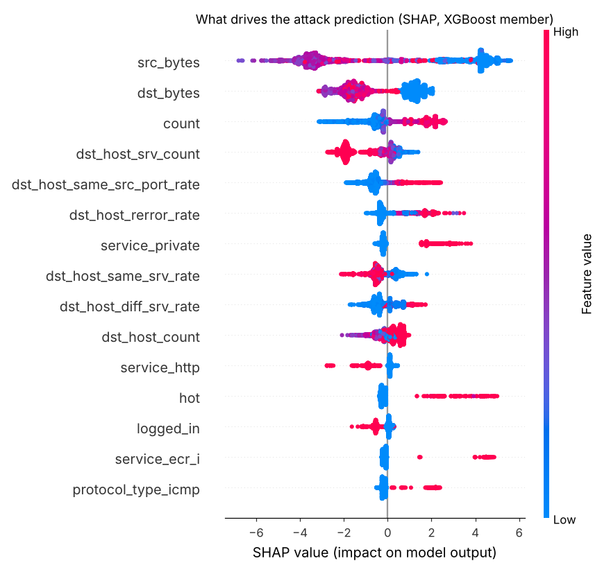

# Network Intrusion Detection: Ensemble ML, Zero-Day Anomalies and SHAP

[](https://github.com/Drakeion2532/network-intrusion-detection/actions/workflows/tests.yml)

An explainable intrusion detection system (IDS) for network flows. It uses a **supervised ensemble** (Logistic Regression + Random Forest + XGBoost) to catch known attacks and an **Isolation Forest trained only on normal traffic** to catch attacks it has never seen. **SHAP** explains every alert so a SOC analyst can see why it fired. A REST API scores flows in real time.

Built on the **NSL-KDD** benchmark. The official test set contains **17 attack types that never appear in training**, which is the realistic part. Clean random splits of this data give 99% accuracy, and this project deliberately avoids that shortcut.



## Results on the official KDDTest+ (22,544 flows)

| Model | Accuracy | Precision | Detection rate | F1 | FPR | ROC-AUC |
|---|---|---|---|---|---|---|
| Logistic Regression | 74.5% | 91.3% | 60.9% | 0.731 | 7.6% | 0.793 |
| Random Forest | 78.3% | 96.9% | 63.9% | 0.770 | 2.7% | 0.963 |
| XGBoost | 79.3% | 96.9% | 65.9% | 0.784 | 2.8% | **0.970** |
| Soft-voting ensemble | 78.5% | 96.9% | 64.2% | 0.773 | 2.7% | 0.961 |
| Isolation Forest (normal-only) | 74.3% | **97.8%** | 56.2% | 0.713 | **1.7%** | 0.949 |
| **Hybrid (ensemble OR anomaly)** | **82.1%** | 97.0% | **70.8%** | **0.819** | 2.9% | – |

**Zero-day detection.** These are the 3,750 test flows from attack types never seen in training:

| | Detected |
|---|---|
| Supervised ensemble | 32.8% |
| Isolation Forest | 42.1% |
| **Hybrid** | **54.9%** |

### What this shows

* On the test set, the supervised ensemble detects **77%** of attacks whose type appeared in training but only **33%** of attacks of new types. That gap is the core weakness of signature-like ML IDS.
* Adding an anomaly detector that only knows "normal" raises zero-day detection by about **1.7×** (32.8% → 54.9%) while keeping false positives under 3%.
* XGBoost on its own scores slightly higher than the soft-voting ensemble (ROC-AUC 0.970 vs 0.961). On this test set the ensemble adds nothing over XGBoost, so using XGBoost alone would be a fair simplification.
* The 5-class XGBoost categoriser reaches 77.5% accuracy (DoS 83%, Probe 65% recall). R2L/U2R recall is low (9% / 5%) because those classes are rare in training and mostly unseen in test. This is a known open problem on NSL-KDD.
* SHAP shows the model relies on sensible signals: tiny `src_bytes` with a high connection `count` (SYN floods), `service_private` (port scans), and `hot` indicators (R2L).

Full metrics, including confusion matrices, are in [`results/metrics.json`](results/metrics.json).

## Run it

```bash
pip install -r requirements.txt
python -m nids.train            # trains everything, writes results/metrics.json + models/nids.joblib (~3 min)
python -m nids.explain          # SHAP summary plot
pytest -q

uvicorn nids.api:app --port 8001
```

```bash
curl -X POST localhost:8001/predict -H 'content-type: application/json' -d @examples/flow.json
```

Response for a SYN-flood (`neptune`) flow from the test set:

```json
{"results": [{"attack": true, "probability": 1.0, "category": "DoS", "zero_day_anomaly": true, "severity": "high",
  "reasons": [{"feature": "src_bytes", "impact": 4.234, "direction": "towards ATTACK"},
              {"feature": "count", "impact": 2.154, "direction": "towards ATTACK"},
              {"feature": "service_private", "impact": 1.774, "direction": "towards ATTACK"}, "..."]}]}
```

## Pipeline

1. **Features.** 40 NSL-KDD flow features: one-hot `protocol/service/flag`, log-scaling for heavy-tailed byte and count features, standardisation.
2. **Supervised ensemble.** Soft voting (weights LR:RF:XGB = 1:2:2) for binary detection, plus a 5-class XGBoost for the attack category (DoS / Probe / R2L / U2R).
3. **Anomaly detector.** Isolation Forest fitted on normal training traffic only. Its threshold is the 99th percentile of normal scores, which gives a false-positive budget of about 1%.
4. **Hybrid decision.** Raise an alert if either detector fires and tag it `zero_day_anomaly` when only the anomaly model saw it.
5. **Explainability.** SHAP TreeExplainer on the XGBoost member returns the top 5 reasons per flow.

## Dataset

`data/KDDTrain+.txt.gz`, `data/KDDTest+.txt.gz`: NSL-KDD, Canadian Institute for Cybersecurity (Tavallaee et al., *A Detailed Analysis of the KDD CUP 99 Data Set*, 2009).

## Roadmap

- [ ] Live capture: CICFlowMeter → API to score real traffic from a SPAN port
- [ ] Retrain and validate on CIC-IDS2017 / UNSW-NB15 (modern attacks)
- [ ] Autoencoder anomaly detector and drift monitoring
- [ ] Alert forwarding to a SIEM (Wazuh / Splunk HEC)
